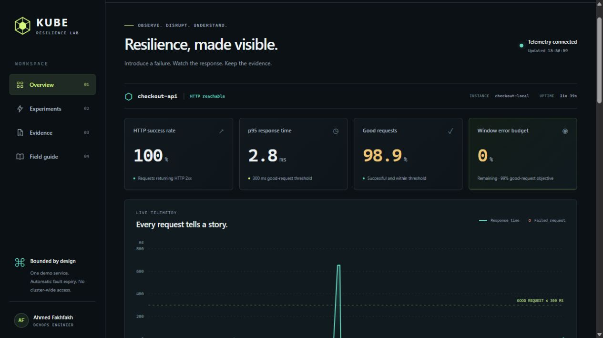

# Kube Resilience Lab

**Provoquer une panne limitée. Mesurer son impact. Conserver les preuves.**

[English](README.md) · [Architecture](docs/architecture.md) · [Portfolio d'Ahmed](https://ahmed-fakhfakh-portfolio.vercel.app/?lang=fr)

Un projet DevOps interactif pour comprendre les liens entre comportement HTTP, objectifs de service et sondes Kubernetes. Le contrôleur mesure un véritable service de démonstration, applique une panne limitée dans le temps et produit un rapport **référence → panne → reprise**.

Projet maintenu par **Ahmed Fakhfakh**. Interface en français et en anglais. Aucun abonnement cloud ni clé d'API IA nécessaire.



[Résultats Kubernetes mesurés](docs/verification.md) : quatre scénarios validés, dont le retrait du point de terminaison et le redémarrage du conteneur par le kubelet.

## Démarrage local

Prérequis : **Node.js 22 ou plus récent**. Aucune dépendance npm d'exécution.

```bash
git clone https://github.com/fakhfakhahmed/kube-resilience-lab.git
cd kube-resilience-lab
npm run dev
```

Ouvrir **http://127.0.0.1:8080**, sélectionner le français et saisir la clé de contrôle temporaire affichée dans le terminal. Choisir une expérience, puis la lancer. `Ctrl+C` arrête les services.

Les graphiques utilisent les observations HTTP réelles. Aucune mesure n'est préremplie pour donner l'apparence d'une expérience réussie.

## Les quatre scénarios

| Scénario | Panne injectée | Observation attendue |
|---|---|---|
| Latence | Délai supplémentaire de 650 ms | Hausse du p95 et baisse des requêtes respectant l'objectif |
| Erreurs HTTP | Une requête de travail sur deux échoue | Baisse de disponibilité |
| Readiness | Échec de la sonde de disponibilité | En Kubernetes, le Service ne route plus vers la cible |
| Liveness | Échec de la sonde de vivacité | En Kubernetes, redémarrage du processus cible |

La reprise automatique liée aux sondes est démontrée **en Kubernetes**. Le mode local permet de tester les échanges HTTP et les rapports, mais ne reproduit pas le comportement d'un kubelet.

## Déploiement Kubernetes

Avec Docker démarré, Node.js 22+, Kind et kubectl installés :

```bash
bash scripts/kind-up.sh
```

Sous Windows PowerShell :

```powershell
.\scripts\kind-up.ps1
```

Suivre les instructions affichées pour le transfert de port et la clé de contrôle. Le cluster dédié s'appelle `kube-resilience-lab` ; les commandes ciblent explicitement son contexte.

Pour vérifier le comportement réel des sondes :

```bash
node scripts/k8s-smoke.mjs
```

Le test produit des preuves dans `artifacts/`. La CI exécute aussi un test Kubernetes isolé et publie ses résultats comme artefact de workflow. La configuration Prometheus/Grafana optionnelle se trouve dans [`deploy/monitoring`](deploy/monitoring).

## Ce que ce projet démontre

- Séparation entre disponibilité HTTP et requêtes respectant un seuil de latence.
- Distinction entre readiness, routage Service et redémarrage par liveness.
- Application sans droits d'écriture sur l'API Kubernetes.
- Contrôles authentifiés, cible fixe, une expérience active à la fois et expiration autonome des pannes.
- Conteneurs non-root, ressources limitées, système de fichiers en lecture seule et jeton de ServiceAccount désactivé.
- Rapports JSON inspectables, tests automatisés et chaîne CI reproductible.

## Vérification

```bash
npm test
npm run check
kubectl kustomize deploy/base
```

## Limites explicites

Ce laboratoire n'est pas destiné à la production. Les statistiques portent sur une petite fenêtre d'observation ; elles ne prouvent ni un SLA mensuel ni une performance sous forte charge. L'historique est en mémoire et disparaît au redémarrage du contrôleur. Un seul contrôleur et une seule cible sont pris en charge.

Les NetworkPolicies nécessitent un CNI qui les applique. L'application ne doit pas être exposée publiquement sans couche d'accès adaptée. Aucun opérateur Kubernetes personnalisé, mécanisme multicluster, synchronisation GitOps ou diagnostic IA n'est revendiqué dans cette version.

Licence MIT — [LICENSE](LICENSE).
