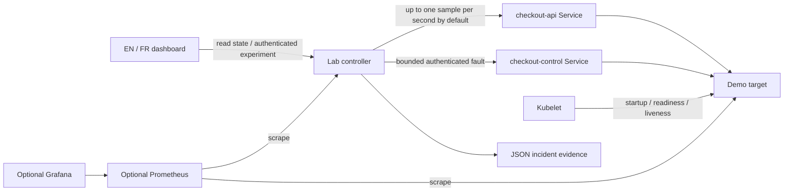

# Architecture and engineering decisions

Kube Resilience Lab turns a failure experiment into inspectable evidence: what was observed before the fault, during it, and after it cleared. It intentionally uses a small application to make the Kubernetes and delivery behavior easy to reproduce.

## Why two Services for the target?

The traffic Service respects readiness. When its only target becomes unready, normal requests cannot reach that target. The control Service uses `publishNotReadyAddresses` so a reset request can still reach the deliberately unhealthy application. This control channel is fixed by configuration; visitors cannot submit an arbitrary URL to probe.

The target expires faults independently. The controller disappearing does not leave an indefinite injected failure. A liveness failure is also held in process memory: after Kubernetes restarts that process, it starts healthy.

Each work sample opens a fresh HTTP connection so it observes the Service's current endpoint routing. Long-lived production connections can behave differently when readiness changes; this lab does not claim to test connection draining.

## No cluster credentials in the application

The application does not call the Kubernetes API, delete Pods, or execute shell commands. The two Pods disable automatic service-account token mounting. A liveness experiment asks the demo target to fail its own health endpoint; the kubelet performs its ordinary probe-driven recovery.

## Three separate questions

1. **Did HTTP requests succeed?** Availability counts successful HTTP responses.
2. **Were requests good enough?** A good request must also finish within the configured latency threshold.
3. **Did the deployment recover?** Experiment reports preserve the observations from each phase. Kubernetes smoke tests additionally inspect Pod restart counts for the liveness experiment.

The dashboard's rolling error-budget estimate is an educational calculation over a small sample window. It is not a monthly production SLO, a load test, or proof of high availability. The default target has one replica so readiness loss is deliberately visible.

## Deliberate tradeoffs

| Choice | Benefit | Limit |
|---|---|---|
| Node.js built-in HTTP and test modules | Small runtime surface; no runtime package dependencies | Not a general application framework |
| In-memory experiment records | Easy local startup and reproducible lab | Restarting the controller loses history; download evidence |
| One controller and one target replica | Deterministic fault ownership | No distributed experiment coordination |
| Application-level bounded faults | No Kubernetes write permissions | Does not emulate kernel, network-device, or cloud-provider failures |
| Local port-forward access | No public endpoint or cloud bill needed | Multiuser/public hosting needs additional authentication and ingress design |
| Optional NetworkPolicy | Documents intended communication paths | Enforcement depends on the cluster CNI |

## Boundaries

Use a dedicated lab namespace and the provided demo target. Do not point this application at an employer's systems. The control key authorizes mutations; read endpoints expose operational data and therefore belong behind local access or an appropriate access layer. This is a portfolio and learning project, not a production chaos platform.

## Primary references

- [Kubernetes probe behavior](https://kubernetes.io/docs/concepts/workloads/pods/probes/)
- [Configure readiness and liveness probes](https://kubernetes.io/docs/tasks/configure-pod-container/configure-liveness-readiness-probes/)
- [Kind local image loading](https://kind.sigs.k8s.io/docs/user/quick-start/)
